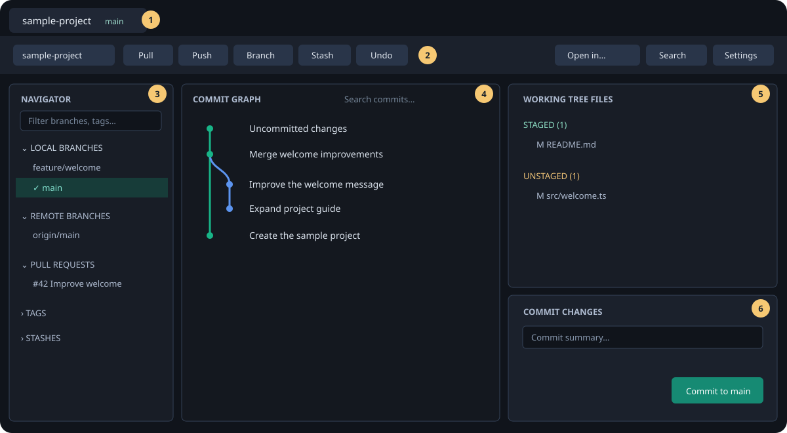
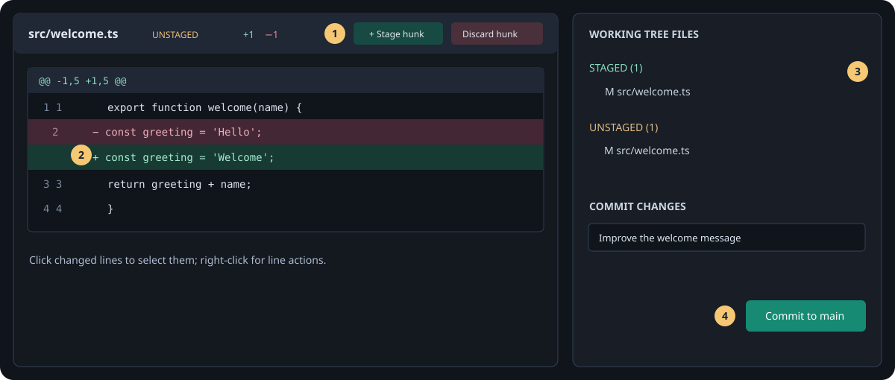
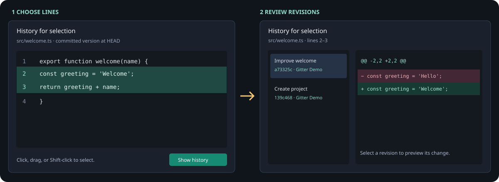
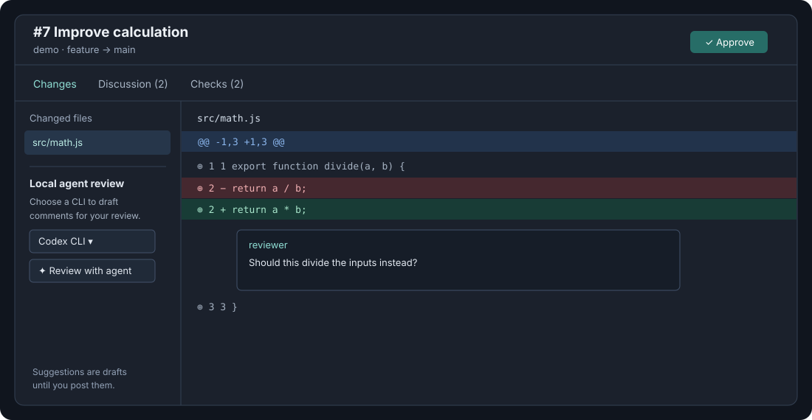

# Gitter visual user guide

Gitter helps you inspect a repository, review changes, and work with Git from a
desktop window. The illustrations below use a sample repository; your branches
and files will be different.

## Find your way around

1. **Repository tabs** keep several repositories open. Click a tab to switch.
2. **Toolbar** contains pull, push, branch, stash, undo, **Open in…**, the
   command palette, and settings. Narrow windows put some actions under **…**.
3. **Navigator** lists branches, pull requests, tags, and stashes. Use its
   filter to find a name and its settings icon to choose visible sections.
4. **Commit graph** shows history. Click a commit to inspect its files; click
   an uncommitted-changes row to return to the working tree.
5. **Working tree** separates staged and unstaged files. Click a file to review
   its diff in the center; its right-click menu offers more actions.
6. **Commit changes** holds the summary, optional description, and commit
   button. Only staged changes are included in an ordinary commit.

Drag the dividers to resize panels. **⌘B** on macOS or **Ctrl+B** on Windows
shows or hides the navigator; **⌘J / Ctrl+J** toggles the working tree.

The window title follows the active repository, its branch or detached HEAD,
and its number of changed files. On macOS, use the **Gitter** menu for
**About Gitter**, **Settings…** (⌘,), and **Check for Updates…**. The File,
Repository, View, Window, and Help menus expose the corresponding actions.
Opening a downloaded Mac disk image does not install or restart the app: quit
Gitter and drag the app from the image into Applications to update it.

## Open or clone a repository

1. Use the **+** beside the repository tabs, then choose **Open folder…**,
   **Find in folder**, or **Clone**. Recently opened repositories are listed
   under **Recent**.
2. To clone, enter a Git URL or browse an authenticated GitHub or Bitbucket
   account. Choose HTTPS or SSH and the destination folder, then clone.
3. Set a default destination in **Settings → General → Repositories**. Gitter
   also offers recently used clone folders.

GitHub browsing uses your signed-in GitHub CLI (`gh`). For Bitbucket Server or
Data Center, add the server and personal access token in **Settings →
Integrations**. The Bitbucket API token is separate from credentials used by
Git over HTTPS; Git uses your configured credential helper for those.

For SSH, use **Settings → SSH keys** to generate or copy a public key and open
the provider's key settings. The key lives in your normal SSH configuration and
can be used by command-line Git too. Share the **public** key, never the
private key.

## Browse branches and history

- Click a branch once to reveal its tip in the graph. Double-click it to check
  it out. Use the branch's right-click menu for more actions.
- In **Remote Branches**, the `origin/` prefix is hidden for readability.
  Branches from other remotes retain their remote name.
- Click a commit to see its files, then click a file for its diff. The commit
  and file context menus include actions such as compare, revert, and restore.
- To compare two commits, select one, then select the other while holding
  **⌘ / Ctrl** or **Shift**.
- Open **File history** from a file's diff or its context menu. Select a
  revision to see its change. **Compare with working tree** compares that
  version with the current tracked file, including staged and unstaged edits;
  switch back with **Show commit change**.
- **Blame** shows the most recent commit and author for each line. Lines that
  have not been committed yet are marked with a zero commit ID.
- Open **Search text or directory history…** from the command palette to find
  commits that add or remove a literal line of text. Add a repository-relative
  directory or file to narrow the search, or leave the text blank to browse a
  directory's history. Select a commit and file to inspect the patch. Search
  covers reachable branches, tags, and remotes and shows up to 300 commits.
- Right-click a local or remote branch and choose **Branch timeline** to see
  its recent commits, related pull requests and checks, and matching Gitter
  agent activity. Pull requests are matched by branch name; compare the PR
  head with the selected branch tip before assuming they are identical.

## Review, stage, and commit

1. Click an unstaged file. Green lines were added; red lines were removed.
   Use **Unified** or **Side by side** in the diff toolbar to change the view.
2. Use **Stage hunk** to stage a whole block. Click changed lines to select
   them, then use the selection actions or right-click to stage only those
   lines. You can unstage or discard changes from the corresponding views.
3. Check the **Staged** section before committing. You can move a file back
   using its unstage action.
4. Enter a summary and select **Commit to _branch_**. Add a description or
   choose **Amend** when needed. Push when you want to send commits to a remote.

Discard and revert operations change your working files. Review the selected
lines and confirmation before continuing. Whitespace-only changes can be
hidden, but partial staging is unavailable while whitespace is hidden.

## See history for selected lines

1. Open a file's diff and choose **History for selection** in its toolbar. You
   can also open it from **File history** or **Blame**.
2. Click one line, drag across lines, or click a line and **Shift-click**
   another to select a range. Select **Show history**.
3. Choose a revision on the left to see the change to those lines. Use
   **Open commit** to inspect all files in that commit, or **Choose lines** to
   change the selection.

The picker deliberately shows the file as committed at the selected revision
(or at `HEAD` for a working-tree file). Uncommitted edits are not part of the
history. A new file has no selection history until it has been committed.
Git traces the line range through its history, including supported renames;
very large and binary files are not available in this view.

## Pull requests

For a repository with a supported connected remote, open **Pull requests** in
the navigator. Select a PR to view its changes, discussion, reviews, and
builds. Bitbucket Server/Data Center drafts appear alongside open PRs. The
**+** can start a PR where the provider and branch support it. Gitter's
Bitbucket creation flow currently supports PRs within one repository.

1. Filter and select a changed file, then use **Previous** and **Next** to move
   through long diffs. Click the comment icon beside a line, write a comment,
   and choose **Post comment**. Existing inline comments appear beneath their
   lines; **Discussion** also lists comments and replies.
2. Use **Checks** to inspect CI results and review states. Select **Approve**
   when you are ready to approve the displayed PR revision. Refresh the review
   when the source branch changes.
3. To get suggestions, choose **Codex CLI** or **Claude Code CLI** and select
   **Review with agent**. The CLI must be installed and signed in. A local
   invocation may send the chosen scope to the CLI's AI provider.
   Choose the visible diff page, current file, or entire pull request;
   scopes are limited to 200,000 characters. Suggestions are drafts and are
   never posted automatically. Select a suggestion to edit it, then use
   **Post comment**. Only locations present in the chosen diff can be suggested.

The provider controls review permissions and which checks are available. A
comment or approval can fail if the PR changes, your token lacks permission, or
the provider cannot anchor that line. Refresh and inspect the latest diff.

If a Bitbucket token expires, use **Settings → Integrations → Update token**.
On macOS, Gitter stores the token unencrypted in a file restricted to your user
account, without using Keychain. Removing the connection deletes the saved
token. Other applications running as your user may be able to read it.

## Resolve a conflict

Right-click a conflicted working-tree file and choose **Resolve conflict**.
Use the arrows to navigate conflict blocks, then choose either side or keep
both in the desired order. The middle pane previews the entire result with
syntax highlighting for supported file types; choose **Edit** to adjust it.
Review the preview before **Save and mark resolved** writes and stages the
file. Gitter refuses to overwrite the file if it changed on disk while the
resolver was open.

## Choose a theme and external apps

Open **Settings → General → Appearance** to choose **Gitter dark**, **Codex**
(neutral dark), or **Claude** (warm light with serif headings). Choose separate
**Interface font** and **Code and diff font** families from the installed-font
list, or enter a family name. The preview and app update immediately; choices
are remembered. Use **Theme default** to restore the theme's font. For aligned
code and diff columns, choose a monospaced font; diff size is in **Diffs**.
The same **Code and diff size** and **Code line height** settings apply in
diffs, pull request reviews, blame, selection history, and conflict resolution.

Use **Search settings** to find a control across the settings pages. **Reset**
restores one choice, and **Reset section** restores the choices in that General
section. In **Settings → Settings backup**, select sections to save or copy as
JSON. To restore a backup, choose the file or paste the JSON, preview it, select
sections, and apply them. Backups omit repository paths, recent repositories,
accounts, tokens, and Open in commands. Repository Git settings and integration
credentials stay on the original machine.

Choose **Follow system appearance** to use Gitter dark in dark mode and Claude
in light mode. **Interface scale** enlarges the whole desktop interface,
including icons, panels, and code; **Interface text size** adjusts interface
text separately. The View menu offers Zoom In, Zoom Out, and Actual Size.

The **Anthropic Sans** option uses the font from a local Claude Desktop
installation on macOS when available, or a matching system-installed family.
Gitter does not include the font in its installers. If it cannot be found, the
interface uses a system fallback and Settings shows that status.

These are Gitter themes inspired by the apps. The [configuration roadmap](JETBRAINS_INSPIRED_ROADMAP.md)
compares Gitter with JetBrains' settings and outlines future improvements.

Use **Open in…** in the toolbar or a repository tab's context menu to open the
repository in an editor, coding app, or terminal. In **Settings → Open in**,
enable, reorder, configure, or add applications. For custom commands, put one
argument on each line and use `{path}` where the repository folder belongs.

## Customize the workspace

In **Settings → Keyboard shortcuts**, search for an action, choose **Record**,
and press the new combination. Gitter rejects conflicts and reserved keys;
app shortcuts do not run in text fields or while a dialog is open. **Commit
from message field** is a contextual shortcut and works in the commit fields.
Its default is ⌘Enter or Ctrl+Enter on macOS, and Ctrl+Enter on Windows.
Clear or reset an individual assignment from the same list.

In **Settings → Toolbar actions**, choose and order up to six repository
actions. In **Settings → Panel layouts**, save the current panel widths and
visibility under a name, then apply, update, or remove that layout. Layouts are
local to this installation and do not contain repository tabs or commit drafts.

## Templates and local actions

In **Settings → Templates**, enter personal or repository-specific commit,
branch-name, and pull-request-description templates. Repository templates are
stored in Gitter's local repository data, shared by linked worktrees. A template
can use the literal placeholders `{branch}`, `{base}`, `{repository}`, and
`{date}`; unknown placeholders remain visible. Choose **Template** or **Use
template** in an empty draft to insert it. Existing text and amend messages are
not replaced automatically. For commit messages, Gitter falls back to Git's
configured `commit.template` if no Gitter or enabled-pack template is set.
For a new pull request, **Use GitHub template** explicitly reads a default
`PULL_REQUEST_TEMPLATE.md` from the GitHub repository's default branch, then
the owner's `.github` repository when needed. It checks the repository root,
`.github`, and `docs`, with uppercase and lowercase filenames; it does not list
multiple templates or resolve a fork's upstream target. **Use Bitbucket
template** tries the connected Data Center repository and project settings.
That lookup uses an undocumented Bitbucket UI endpoint and may not work on every
server version or permission setup. All template buttons only fill an empty
description, and a result is discarded if the base or draft changes while it
loads.

In **Settings → Local actions**, configure an executable, one argument per
line, an optional absolute working directory, and a timeout. `{path}`,
`{branch}`, and `{file}` can be used in an executable, argument, or directory;
`{file}` requires a selected file. Launch an action from Settings or the command
palette, review the exact executable and arguments, and choose **Run action**.
Gitter shows bounded output and the exit status. Cancellation targets the
launched process; child processes may continue. Actions run with your operating
system permissions and can access your files and network. Gitter omits inherited
credential-related environment variables, but actions are not sandboxed.
Windows batch files are not supported as executables.

## Data-only extension packs

In **Settings → Extension packs**, choose a pack file or paste its JSON and
preview the contributions before importing it. Imports start disabled. Enable
the pack and, if it contains a theme, choose **Use theme**; disabling or removing
it restores the underlying preferences. Personal shortcuts and templates take
precedence, and conflicting pack shortcuts are skipped.

Packs are limited to validated theme colors, safe view shortcuts, and literal
templates. They cannot run code or commands, inject CSS or HTML, or fetch network
resources. Gitter checks common opaque text colors against three theme surfaces
for low contrast; overlays, interaction states, and other colors still require
review. Pack compatibility is limited to
the declared minimum Gitter version and the same major version. The
[Harbor example](examples/harbor.gitter-pack.json) shows the format. Executable
third-party plugins are not supported.

## Shortcuts and recovery

`Mod` means **⌘** on macOS and **Ctrl** on Windows.

| Shortcut | Action |
| --- | --- |
| `Mod+P` | Open the command palette; choose **Check out branch or tag…** to search branches and tags. |
| `Mod+,` | Open settings. |
| `Mod+=` / `Mod+-` / `Mod+0` | Zoom in, zoom out, or return to actual size. |
| `Mod+T` / `Mod+W` | Open or close a repository tab. |
| `Mod+Shift+N` | Create a branch. |
| `Mod+Shift+S` | Stash changes. |
| `Mod+Z` | Undo the last supported Git action. |
| `Mod+Enter` | Commit from the commit-message field. |
| `F5` | Reload the repository. |

For older Git actions, open **Reflog** from the command palette. Review what a
reset, restore, or revert will change before using it. Git operations use your
installed Git and signing configuration. Lane commits also run Git's normal
commit hooks, including configured hook paths and hooks that edit the message or
stage changes. For a lane on a different branch, Gitter temporarily registers
that branch in a separate Git worktree and index while hooks run against the
current working directory. The current checkout and its index stay as they are;
hooks themselves can change working files, just as with a command-line commit.
A branch already checked out in another worktree cannot be used for a lane.
